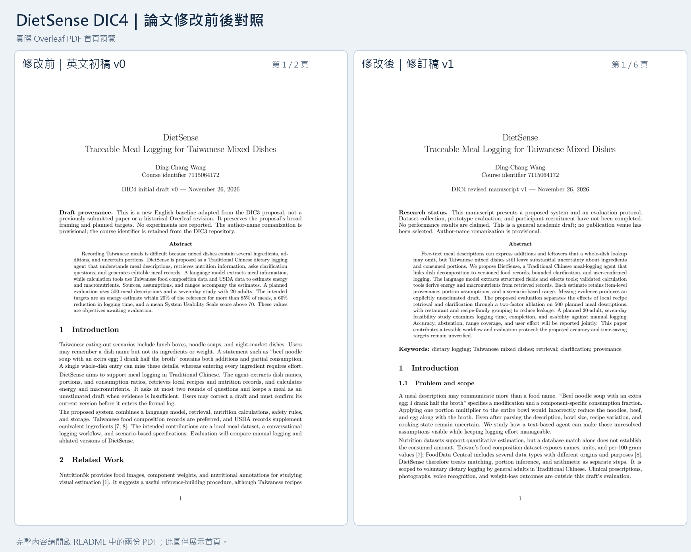

# 王鼎昌 7115064172 DIC4 

本作業延續 [DIC3 DietSense](https://github.com/dennis6651259-hub/1111-DoI3)，完成英文學術論文初稿及修訂稿，並用 OpenSpec 記錄修稿要求。使用者未指定投稿場域，採通用 article 格式。本 repository 為 DIC4 獨立交付入口，論文、規格及匯入檔均由下方連結取得。

## 修改前／修改後 PDF 對照

上圖為兩份實際 Overleaf PDF 的第一頁預覽，點擊圖片可放大；完整內容請開啟下表 PDF。

下表 PDF 為實際從 Overleaf 編譯後下載的版本；點擊即可在 GitHub 閱讀。

| 項目 | 修改前：英文初稿 v0 | 修改後：修訂稿 v1 |
| --- | --- | --- |
| **PDF 閱讀** | **[開啟修改前 PDF](validation/overleaf/DietSense_DIC4_Before.pdf)** | **[開啟修改後 PDF](validation/overleaf/DietSense_DIC4_After.pdf)** |
| 頁數 | 2 頁 | 6 頁 |
| 版本用途 | 本次依 DIC3 整理的英文基準稿 | 依 OpenSpec 修稿規格完成的學術論文草稿 |
| 修改重點 | 作為後續修訂的比較基準 | 強化 Abstract、Introduction、Related Work，補充研究問題、評估協定與限制 |
| LaTeX 原始檔 | [before/main.tex](paper/before/main.tex) | [after/main.tex](paper/after/main.tex) |
| Overleaf 專案 | [DietSense DIC4 Before](https://www.overleaf.com/project/6b07e4d866226db300e5848a) | [DietSense DIC4 After](https://www.overleaf.com/project/6b07e69a0b58b245f496dacc) |
| Overleaf 編譯 | 0 錯誤、0 警告 | 0 錯誤、0 警告 |

